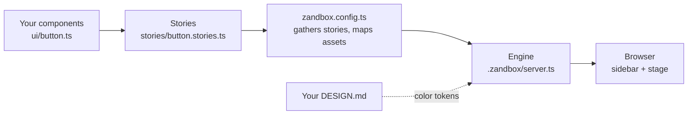

# Zandbox

**A component lab for Bun + HTMX projects.** See every component in every
state, in your browser, styled by your project's real CSS — no build step,
no rendering library, no Storybook-sized dependency tree.

```text
bun run zandbox   →   http://127.0.0.1:8935
```

## Get started

You need Bun and a project to try it in. Four steps, about five minutes:

**1. Clone Zandbox** (once — park it anywhere):

```bash
git clone https://github.com/Klectr/zandbox ~/zandbox
```

**2. Run init from your project's root:**

```bash
cd ~/your-project
bun run ~/zandbox/engine/cli.ts init
```

Init copies the engine into your project's `.zandbox/`, writes a starter
`zandbox.config.ts` and one example story, and adds a `zandbox` script to
your `package.json`. It never overwrites — if a config already exists, it
refuses and changes nothing.

**3. Start the lab:**

```bash
bun run zandbox
```

Open http://127.0.0.1:8935 — the example story renders. The lab works.

**4. Show it your own components.** Two small edits in `zandbox.config.ts`:
map your stylesheet so stories wear production styling, and point
`designMd` at your DESIGN.md if you have one:

```ts
const config: ZandboxConfig = {
  name: "Zandbox",
  stories: [...exampleStories],
  assets: { "/static/style.css": "static/style.css" },
  designMd: "DESIGN.md",
};
```

Then write a story per component (next section) and restart the lab.

## Write a story

A story is one small file per component, kept apart from the component
itself — Storybook's model. It says: here is the component, in these states,
with fictional data.

```ts
// stories/button.stories.ts
import type { Story } from "../.zandbox/story";
import { button } from "../ui/button";

export const buttonStories: Story[] = [
  { id: "button-primary", group: "Components", title: "Button — primary",
    render: () => button("Save changes") },
  { id: "button-ghost", group: "Components", title: "Button — ghost",
    render: () => button("Cancel", true) },
];
```

Register it in `zandbox.config.ts` (`stories: [...buttonStories]`) and
restart. Story ids are lowercase letters, digits, and dashes, and must be
unique — the server refuses to start otherwise, rather than render wrong.

## How it works

Three pieces: **your components** (which never know Zandbox exists),
**stories** (thin files that render them in each state), and **the engine**
(a small Bun server that puts one story at a time on a stage).



- The engine imports **nothing** from your project. Your config is the only
  wiring, and it points one way: config → stories → components.
- Your stylesheet is served as-is, so what you see is production styling,
  not a lab approximation.
- Point `designMd` at a DESIGN.md and the lab adds a **Tokens** story: every
  color token in the file, rendered as a swatch.
- The sidebar filters as you type; `/story/<id>` is a shareable URL per
  story; `/canvas/<id>` renders one story bare, no chrome.

After init, your project looks like this:

```text
your-project/
├── .zandbox/            the engine (vendored — don't edit)
├── stories/             your stories, one file per component
├── zandbox.config.ts    the only wiring
└── ui/                  your components (untouched by Zandbox)
```

## Updating

The engine is vendored, so updating is a copy: delete `.zandbox/`, re-run
init from a fresh Zandbox checkout, done. Your config and stories are
host-side files — init never touches them once they exist.

## The contract, in full

[engine/README.md](engine/README.md) ships with the engine into every host
project and documents the whole contract: the config shape, story rules,
the Tokens story, and the routes.

## Development

```bash
bun test       # engine tests
bun run demo   # examples/basic — a minimal host wired to the engine
```

## License

MIT
